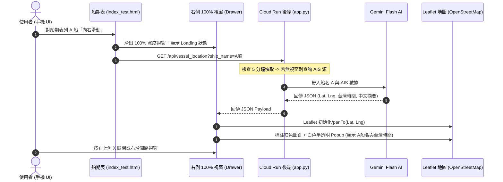

# [測試版] 船舶即時位置查詢與 Leaflet 免費地圖視覺化實作規劃書

## 1. 功能需求與設計目標 (Goal & Requirements)
在 `測試版/` 中為「臺中 LNG 船監控」網頁 APP 新增船舶位置查詢與視覺化功能，完全滿足 0 費用與 GCP 空間限制：

1. **船期表右滑觸發**：使用者在 APP 船期表 (`.schedule-table`) 對目標船隻列**向右滑動 (Swipe Right)**，右側滑出全螢幕 100% 寬度視窗。
2. **輕量級後端與 Gemini 整合 (0 費用 & GCP <500MB)**：
   * 後端 Python 不安裝重型瀏覽器 (如 Chrome/Playwright)，採用輕量 API / HTTP 網頁解析與開放 AIS 數據源獲取座標。
   * 背後透過 `gemini-flash-latest` 模型將數據結構化並轉譯為繁體中文動態摘要，時間統一轉換為**台灣時間 (UTC+8 / Asia/Taipei)**。
3. **視窗與 Leaflet 免費地圖視覺化 (0 費用)**：
   * **100% 螢幕寬度 Drawer**：自螢幕右側向左滑入，頂部設有右上角 `X` 關閉按鈕，並支援右滑關閉。
   * **Leaflet.js + OpenStreetMap 地圖**：透過 CDN 引進 Leaflet.js，0 軟體授權與 0 地圖 API 費用。
   * **紅色圖釘 (Red Pin Marker)**：地圖精準定位至船舶最新座標。
   * **白色半透明資訊視窗 (Popup)**：底色白底 90% 半透明 (Glassmorphism)，字體深藍色 (`#0A2540`)，明確顯示**船名**與**台灣時間最後更新時間**。
   * **地圖互動**：支援手機雙指縮放 (Pinch-to-Zoom) 與手指拖曳平移。

---

## 2. 已決策與審查事項 (Architectural Decisions)

> [!NOTE]
> **環境劃定**：本變更全數限制在 `測試版/`（`測試版/index_test.html` 與 `測試版/app.py` / `測試版/src/`），絕不觸碰 `正式版/`。

> [!IMPORTANT]
> **技術架構決策 (GCP 500MB 空間與 0 費用安全限制)**：
> 1. **後端輕量化**：嚴格禁止安裝 Playwright / Selenium / Headless Chrome，避免 Container Image 超出 GCP 500MB 免費額度。後端以輕量 `requests` / `BeautifulSoup4` + 5分鐘記憶體快取 (Memory Cache) 連線擷取 Marine Traffic / AIS 數據。
> 2. **時區處理**：使用 Python `zoneinfo` / `pytz` 或 JS `Intl.DateTimeFormat` 強制輸出 `Asia/Taipei`（例如：`2026-07-31 20:45:00 (台灣時間)`）。
> 3. **手勢處理**：在 HTML `schedule-table` 的 `<tr>` 綁定 `touchstart` / `touchmove` / `touchend` 事件，判定 `deltaX > 50px` 且 `deltaY < 30px` 觸發右滑開啟視窗。

---

## 3. 系統運作與手勢互動流程 (Sequence Flow)



---

## 4. 預計修改組件與程式碼規劃 (Proposed Changes)

### 前端 UI 與地圖元件 (`測試版/index_test.html` & `測試版/public/index.html`)

#### [MODIFY] `測試版/index_test.html`
1. **載入 Leaflet.js CDN**：
   ```html
   <link rel="stylesheet" href="https://unpkg.com/leaflet@1.9.4/dist/leaflet.css" />
   <script src="https://unpkg.com/leaflet@1.9.4/dist/leaflet.js"></script>
   ```
2. **新增 100% 寬度右側 Drawer 結構與 CSS**：
   ```css
   .vessel-drawer {
       position: fixed; top: 0; right: 0; width: 100%; height: 100%;
       background: #ffffff; z-index: 3000;
       transform: translateX(100%); transition: transform 0.3s cubic-bezier(0.4, 0, 0.2, 1);
       display: flex; flex-direction: column;
   }
   .vessel-drawer.open { transform: translateX(0); }
   .vessel-drawer-header {
       display: flex; justify-content: space-between; align-items: center;
       padding: 16px 20px; background: #10458C; color: white;
   }
   /* 白色半透明 Popup 樣式 */
   .custom-leaflet-popup .leaflet-popup-content-wrapper {
       background: rgba(255, 255, 255, 0.90) !important;
       backdrop-filter: blur(10px);
       color: #0A2540 !important;
       font-weight: 600;
       border-radius: 12px;
       border: 1px solid rgba(16, 69, 140, 0.15);
       box-shadow: 0 8px 24px rgba(0,0,0,0.12);
   }
   ```
3. **JS 向右滑動觸發器 (Swipe Gesture Detection)**：
   * 監聽 `.schedule-table tr` 的手勢滑動，識別向右滑動並取出船名，開啟 Drawer 並呼叫 `/api/vessel_location`。
4. **台灣時間格式化與 Leaflet 打點**：
   * 繪製紅色 SVG/Canvas Icon Marker。
   * 將傳回的 ISO 時間以 `Intl.DateTimeFormat` 轉換為台灣時間（格式：`YYYY-MM-DD HH:mm:ss (台灣時間)`）。

---

### 後端 API 與服務 (`測試版/app.py` & `測試版/src/vessel_location.py`)

#### [NEW] `測試版/src/vessel_location.py`
* 建立輕量化 Marine Traffic / AIS 數據爬取與備用抓取器。
* 對接 Gemini Flash (透過 GCP Secret Manager API Key) 轉譯資訊。
* 包含 5 分鐘記憶體快取 (Dict Cache) 降低重複請求。

#### [MODIFY] `測試版/app.py`
* 增加 Endpoint `/api/vessel_location`。

---

## 5. 驗證與測試計畫 (Verification Plan)

### 自動化測試 (Automated Tests)
1. 執行 `pytest` 測試 `/api/vessel_location` API：
   * 驗證回傳之 JSON 結構包含 `status: "success"`, `latitude`, `longitude`, `taiwan_time`, `vessel_name`。
   * 驗證時區是否精準加上 +8 小時轉為台灣時間。

### 手動與 UI 驗證 (Manual Verification)
1. **手勢開啟**：在手機或瀏覽器觸控模式下，於船期表中選擇任意船隻向右滑動，確認視窗從右側流暢滑出 Covering 100% 畫面。
2. **地圖與圖釘驗證**：
   * 地圖正常顯示 (OpenStreetMap)。
   * 正確出現紅色圖釘，圖釘旁跳出白色 90% 半透明小 Popup。
   * Popup 內容顯示船名與「台灣時間: YYYY-MM-DD HH:mm:ss」。
3. **縮放互動**：測試雙指捏合縮放 (Pinch zoom) 與拖曳地圖，確認標點位置固定且響應流暢。
4. **關閉視窗**：按下右上角 `X` 按鈕，確認視窗流暢向右滑出關閉。
